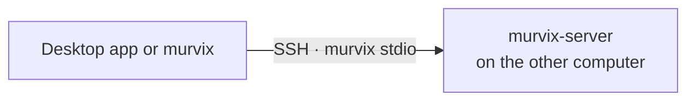

# Remote Servers

Murvix can work with projects on other computers over SSH. Each computer runs its
own `murvix-server`, so remote terminals keep running when you disconnect, just
like local ones. In the desktop app, remote projects sit in the same sidebar
as local ones, marked with their server. A CLI or TUI invocation selects one
server at a time.



## Requirements

- SSH access to the computer with your keys, agent, or certificates. The
  desktop app also supports password logins.
- A trusted host key. You can run `ssh <host>` once to check and accept it, or
  review the fingerprint offered by the desktop app's Test Connection flow.
- Murvix [installed there](../user-guide/getting-started.md#cli-and-server-only),
  on `PATH` or in `~/.local/bin`, at a version that speaks the same protocol as yours.
- macOS 14 or newer, or Linux with glibc 2.35 or newer, on x86_64 or ARM64.

On Linux hosts that end your processes when you log out, run
`loginctl enable-linger` so the server keeps running after SSH disconnects.

## In the desktop app

1. Open the **Remote** section at the bottom of the sidebar and choose
   **Add Server…**.
2. Enter the SSH host (a host name, address, or `~/.ssh/config` alias), and
   optionally the user, port, and identity file.
3. Choose **Test Connection**. If Murvix isn't installed there, a release build
   offers to install its matching version into `~/.local/bin` using `curl`.
   A debug desktop build instead uses a separately prepared
   `target/linux-dev/murvix-dev-linux-x86_64.tar.gz` archive; that path supports
   x86_64 glibc Linux only and fails if the archive has not been built.
4. Add projects with **Add Project → Remote**, which browses the server's
   folders.

The release installer downloads from this fork's GitHub releases. This
repository currently has no published release assets, so do not assume the
automatic install offer can succeed; install a source-built CLI/server pair
on the host, or use the prepared development archive described above.

- Passwords are asked when connecting and kept only in memory until you quit.
- A dropped server reconnects on its own, waiting longer each time. It stops
  retrying when it needs you, for example for a password or a new host key.
- **Forget** a server to remove it and its projects from this app. Nothing on
  the server changes.
- The status bar shows the current project's server, with connect, restart, and
  stop.

### Custom SSH commands

If a VM manager or another tool handles SSH for you, turn on **Custom command**
in **Add Server…** (or **Edit…**) and enter its command prefix, for example:

```text
swiftvm ssh my-vm
```

Murvix runs that local program directly and appends its remote command as **one
argument**. The prefix must include the target machine and any flags or `--`
separator your tool needs. Murvix does not add SSH flags, a host, or a port in this
mode. The same prefix is used for Test Connection, installation, normal
connections, and reconnects.

- The tool must accept a remote shell command as its last argument and relay
  stdin/stdout unchanged **without allocating a TTY**. Interactive-shell-only
  tools are not supported. Add your tool's non-interactive/no-TTY flags if needed.
- Authentication and host-key verification belong to the tool. Set them up in a
  terminal first; Murvix's password and identity-file controls do not apply here.
- Single/double quotes and backslashes group arguments, so paths and VM names
  can contain spaces. Shell variables, `~`, wildcards, pipelines, redirects,
  aliases, and command substitutions are not expanded. Use an absolute program
  path if the tool is not on the desktop app's `PATH`.
- Only configure commands you trust: they run locally with your permissions on
  connection and reconnection. Do not put passwords or tokens in the command;
  it is saved in plain text in `settings.toml`.

For tools with a different argument convention, use an executable wrapper
script that accepts the last argument as the remote command and forwards it
without changing stdin/stdout. The remote computer still needs Murvix and the
same OS requirements listed above.

A custom-command entry in `settings.toml` uses `ssh_command` instead of `ssh`:

```toml
[[servers]]
id = "6f9619ff-8b86-4011-b42d-00c04fc964ff" # use a unique UUID
name = "Development VM"
ssh_command = "swiftvm ssh my-vm"
```

## From a shell

Put `--host` first to use another computer's server:

```bash
murvix --host devbox                 # terminal UI
murvix --host devbox project list    # server-backed CLI command
murvix --host ssh://me@devbox:2222   # with a user and port
```

`--host` takes `user@host`, a `~/.ssh/config` alias, or
`ssh://user@host:port`. It never prompts, so use a key or an agent and trust the
host key beforehand. Directory arguments to management commands must be
absolute paths on that computer, for example:

```bash
murvix --host devbox project add /srv/my-app --reuse
murvix --host devbox session create /srv/my-app
```

`murvix --host devbox /srv/my-app` is not supported: the folder-opening shortcut
is local-only. Browser and skill-installation commands are local-only too.
The CLI's `MUXY_DIR` is not forwarded to the remote server; that server uses
its remote profile. SSH does not require enabling Mobile access or exposing
port `7419`.

## Working with remote files

- Files dropped or pasted into a remote terminal, or sent from the
  [composer](composer.md), are uploaded and their remote path is pasted.
- Modified-clicking a remote file (**Cmd** on macOS, **Ctrl** on Linux) offers
  a read-only local copy or its path. The file must be reachable within the
  server's allowed project roots for **Open a Copy**.
- Git runs on the server. Pull request features need `gh` installed and signed
  in there.
- AI commit and pull request actions obtain repository state and apply changes
  through the server, but the AI provider runs on the desktop computer in the
  project's directory. That same directory must exist locally for generation;
  remote-only checkouts are not supported by these AI actions.

## Updating

Murvix never updates a remote computer by itself. When versions can't talk, the
app shows the command to run there. To update by hand, follow
the [installation instructions](../user-guide/getting-started.md#cli-and-server-only)
on that computer with `--replace` and an exact `--version` compatible with your
client. The standalone installer has no channel option.
