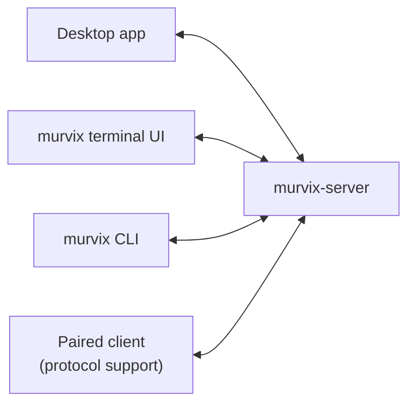

# Server

`murvix-server` runs every terminal. The desktop app, terminal UI, and CLI are
clients of it. It also implements paired-device network access; phone apps
are not shipped in this repository (see [Mobile](mobile.md)). Keeping terminals
in the server lets them survive closing a client and lets several clients show
the same terminal.



## Lifetime

- Apps and server-backed CLI commands start the server when they need it.
  You can also start it explicitly with `murvix server start`; status and stop
  commands never start it.
- It keeps running until you stop it, even with no app open.
- Stopping or restarting it ends every terminal. Saved screens and history are
  kept. Use the status bar, **Settings → Server**, or
  `murvix server stop --force`.
- Murvix never restarts it on its own while terminals are running. After an
  update, the desktop app replaces this computer's server once no terminals are
  running.

## Sessions

- A session is one running terminal. It belongs to the project it was created
  in, wherever you `cd` later.
- It ends when its program exits, when someone ends it, or when the server
  stops. Closing its last pane also ends it **and discards its saved output**,
  unless another connected client still references it.
- Quitting or detaching a client, a client crash, or sleep does not itself end
  a session. A server crash, reboot, or operating-system process cleanup can.
- Multiple clients can show and type into a session at once. They share one
  size; resizing or attaching a client can resize the terminal for everyone.
- **Existing Terminals** lists a project's sessions that this app isn't
  showing, and which app owns each one, so you can open them here too.

## History

- The server checkpoints each terminal's screen and scrollback to disk after
  changes (normally about once a second), even when no app is watching, and
  saves again when the program ends. A crash can lose changes since the last
  successful checkpoint.
- Saved output survives a server restart, but running programs do not. Closing
  the last pane, discarding a session, or deleting its project removes its
  saved output.
- Scrollback size is a byte budget per terminal, 16 MiB by default. Older
  history loads as you scroll.
- Ended sessions and their saved output are removed after 7 days.

## Settings

Server settings apply to everyone using that server. Change them in
**Settings → Server**, with `murvix settings set`, or in `server.toml`:

| Setting | `server.toml` key | Default |
| --- | --- | --- |
| Default shell | `default_shell` | The server's `$SHELL` (on Linux, only an absolute executable file), else `/bin/zsh` on macOS and `/bin/sh` on Linux |
| History budget per session | `history_budget_bytes` | `16777216` (16 MiB) |
| Shell integration | `shell_integration` | `true` |

Shells start as login shells. Changes made through Settings or the CLI apply to
new terminals; existing terminals keep their current shell and scrollback
budget. The archive's saved-history budget changes after a server restart.
Direct edits to `server.toml` are read at startup, not hot-reloaded. CLI setting
names use hyphens: `default-shell`, `history-budget-bytes`, and
`shell-integration`; use `default` to clear the shell override.

## Shell integration

Shell integration lets Murvix track each terminal's folder, jump between prompts,
and select a command's output. It loads automatically for zsh and fish, without
editing your startup files.

Bash is opt-in. Add this to the file your Bash profile loads for interactive
shells:

```bash
if [[ ${MUXY_SHELL_INTEGRATION:-0} == 1 ]]; then
    source "$MUXY_SHELL_INTEGRATION_DIR/murvix.bash"
fi
```

Every terminal gets `TERM=xterm-256color`, `COLORTERM=truecolor`,
`TERM_PROGRAM=murvix`, `MUXY_SERVER_ID`, and `MUXY_SESSION_ID`.
The project workspace is also advertised through `MUXY_WORKSPACE_COUNT` and
`MUXY_WORKSPACE_0`, `MUXY_WORKSPACE_1`, and so on. These are terminal-start
snapshots. `murvix project here` instead queries the calling terminal's live
project through its server and session identity, so existing terminals see
added and removed roots. `murvix agent` uses that same lookup before launching
supported agents with native additional-directory options.

## Networking

Local clients use `server.sock`, a Unix-domain socket. SSH connections run
`murvix stdio` on the remote computer and relay that server's socket; they do
not require the paired-device listener.

Network access is disabled by default. Enabling **Settings → Mobile** or
`murvix mobile enable` starts a TLS 1.3 listener on all IPv4 interfaces, on
port `7419` by default. Pairing pins the server certificate and issues a
per-device credential. See [Mobile](mobile.md) for access scope and pairing.


## Files

Everything lives in one profile folder:

| Platform | Profile folder |
| --- | --- |
| macOS | `~/Library/Application Support/Murvix` |
| Linux | `$XDG_STATE_HOME/murvix`, or `~/.local/state/murvix` |

| File | What it holds |
| --- | --- |
| `server.toml` | Server settings |
| `server.log` | Server log |
| `server.sock` | The socket apps connect to |
| `sessions/` | Projects, sessions, and saved terminal output |
| `settings.toml`, `terminal.toml`, `themes/` | Desktop app settings, see [Settings](../user-guide/settings.md) |
| `tui-state.json` | Local terminal UI layout |
| `servers/<server-id>/tui-state.json` | Terminal UI layouts for remote servers, stored locally |
| `remote.json` | Network-access settings, server TLS identity/private key, and paired-device token hashes; keep private |
| `shell-integration/` | Generated shell startup hooks |

Set `MUXY_DIR` to use a different profile folder. Debug builds default to
`Murvix Dev` (`murvix-dev` on Linux); an explicit `MUXY_DIR` overrides that
separation. CLI and desktop clients must use the same profile to share its server.
