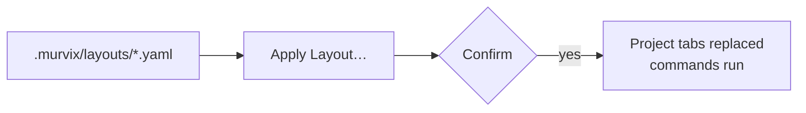

# Layouts Overview

A layout is a file in your project that describes a tab of split terminals.
Check it in so other desktop users of the project can choose the same layout,
review the replacement confirmation, and run its commands.



## Pages

| Page | What's in it |
| --- | --- |
| [Schema](schema.md) | Fields, splits, and the JSON form |
| [Examples](examples.md) | Ready-to-copy layouts |

## How it works

- Put layout files in `.murvix/layouts/` inside a project or worktree folder.
  Remote projects work too.
- Use `.yaml`, `.yml`, or `.json`. The file name, without its extension, is the
  layout's name.
- Apply one from the project's menu with **Apply Layout…**, or from the layout
  button in the top bar. The button appears when the project has at least one
  discovered layout.
- Layouts are never applied automatically.
- Applying asks first, then replaces all of the project's tabs in this app,
  pinned tabs included, and runs the layout's commands in new terminal sessions.
  The old sessions end if no connected app still references them; their saved
  output is discarded too. Other projects' tabs are unchanged.
- Layouts are a desktop app feature. The `murvix` terminal UI does not read them.
- The server must be connected to discover and load a layout, including for a
  local project. A file that cannot be parsed does not replace any tabs.

Only apply layouts you trust: their commands run as you.

```
my-project/
  .murvix/
    layouts/
      dev.yaml
      release.yaml
```
