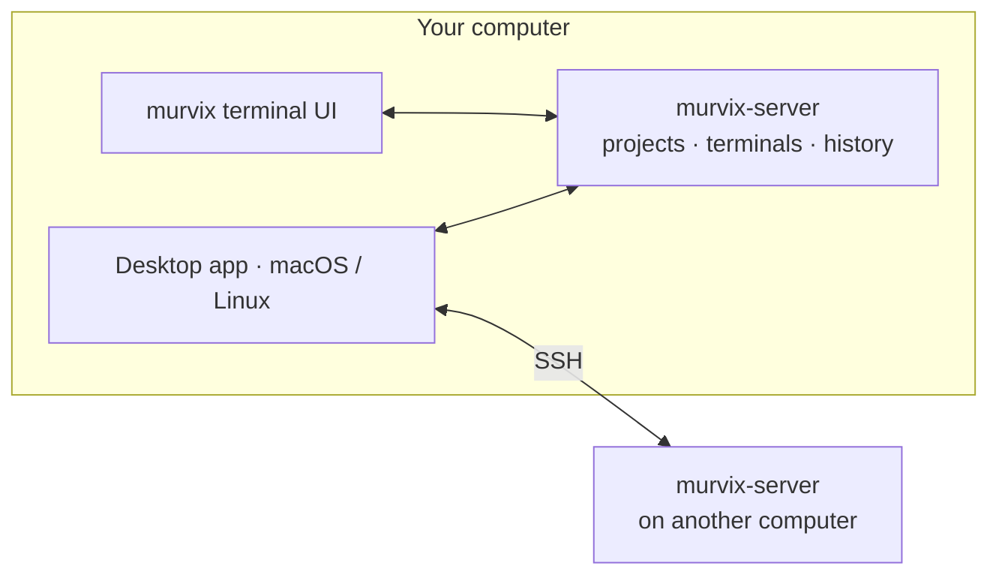

# Murvix

Murvix is a terminal multiplexer. You organize your work into projects and work
in tabs and split panes. Terminals run in a background server, so they keep
running when you close the app, and several apps can show the same terminal at
once.

The desktop app and terminal UI are implemented here. The server also implements
TLS access and pairing for mobile clients, but this repository does not ship a
phone app; phone UI and phone SSH support are design intent, not current apps.

Three ideas explain most of Murvix:

- **The server owns the work.** Projects and terminal sessions live in the
  server, not in the apps.
- **Each app owns its view.** Tabs, split layouts, and project order
  are private to each app.
- **Terminals outlive apps.** Quitting or crashing an app does not end its
  terminals. By default, closing the last pane in connected apps that references
  a terminal ends it; detaching keeps it running.

## Read next

1. [Product model](./product-model.md): projects, worktrees, tabs, panes, and
   sessions.
2. [App model](./app-model.md): the apps, navigation, settings, and updates.
3. [Server model](./server-model.md): how terminals live, are shared, and end.

How it is built: [technical design](../tech/README.md).
