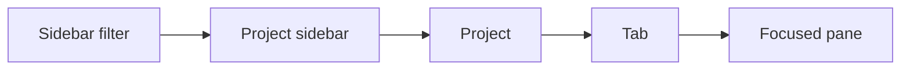
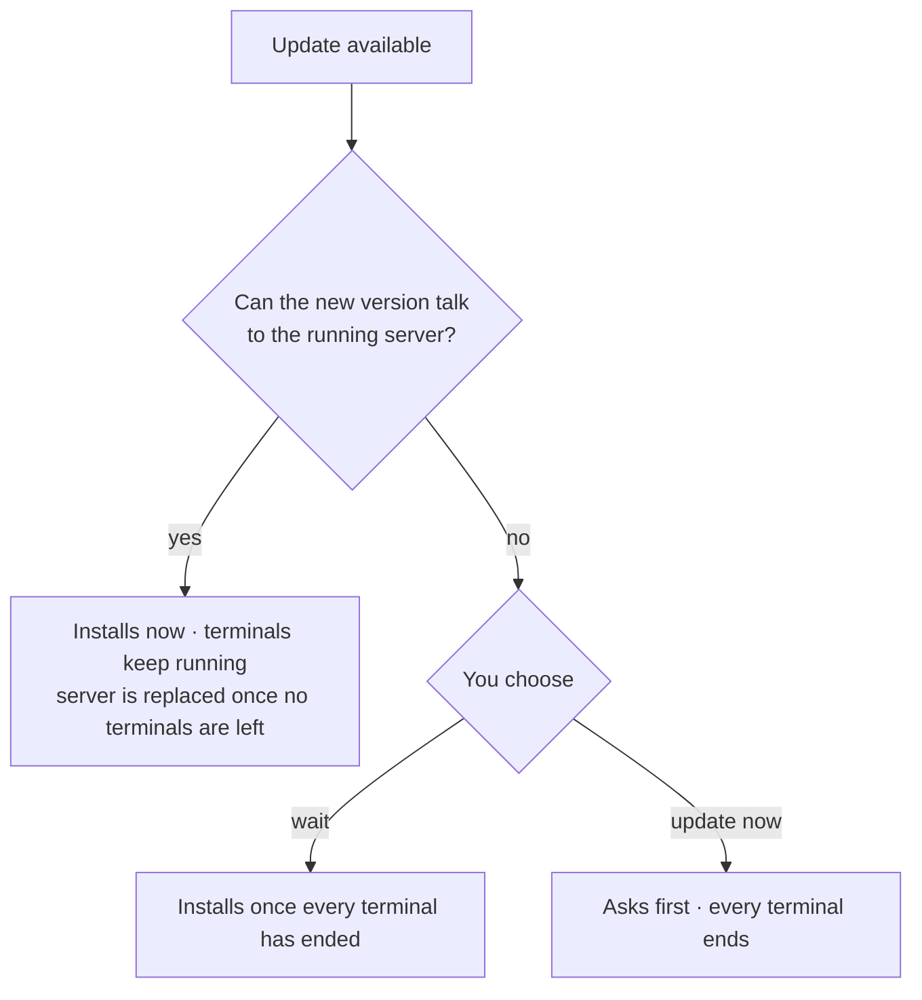

# App model

How people use Murvix: the apps, navigation, settings, and updates.

## The apps

| App | Connects to |
| --- | --- |
| Desktop app (macOS and Linux) | The server on the same computer, starting it if needed, and servers on other computers over SSH. Linux uses X11 or Wayland. |
| `murvix` terminal UI | The server on the same computer, starting it if needed, or with `--host`, the server on another computer over SSH. Ships with the desktop app and also on its own. |

The server's TLS listener, device credentials, and pairing controls are
implemented, but no phone app is shipped in this repository. A phone UI and
phone-to-server SSH connection are planned client behavior, not current apps.

Every project knows which server it lives on, so the desktop app shows
projects from several servers in one sidebar. Remote projects are marked with
their server and path. There is no global "current server".

The **Remote** section at the bottom of the sidebar shows each remote server's
state. Its popover adds servers (host, user, port, key file, or a password that
Murvix asks for and keeps only in memory) and manages them. **Add Project →
Remote** browses that server's folders. When a server lacks Murvix, a released
app offers to install the same version there; when its version can't talk to
the app, the section explains how to update it. Removing a server only forgets
its projects in this app.

**New Tab in Project…** (⌘⇧N on macOS, Ctrl+Alt+N on Linux) lists local and remote
projects. Picking one opens a tab there and shows it in the sidebar if needed;
a remote server opens in its Home, connecting first if needed. Clicking a server
in the Remote popover offers **New Tab** too.

Files and images dropped or pasted on a remote terminal, or sent from the
composer, are copied to that computer and its path is pasted. Clicking a file
path in a remote terminal offers a read-only copy here, or its path.

Each app keeps its own layout: tabs, splits, and project order.
Projects and terminals are shared. Several `murvix` windows can open the same
terminal UI layout.

## Navigation



- The sidebar shows **All Projects** by default. **Focus Current Project**
  narrows it to the project you are working in, and **Remote Servers** lists
  each remote server's Home. Home stays first and worktrees appear under their
  parent.
- One project order applies under every filter.
- Picking a project shows its tabs.
- A window has one focused pane. Closing it moves focus to a neighbor. Closing a
  tab moves focus to the next tab, or the previous one. Closing something in the
  background never steals focus.

## Opening and restoring

- The desktop app restores all projects, tabs, and window state on launch. It
  never opens a tab by itself.
- The terminal UI opens one shell in Home the first time, then restores its
  layout.
- `murvix <folder>` opens the folder in the desktop app, selecting its project or
  adding one. Without the desktop app, or over SSH, it opens in the terminal UI.
- **Existing Terminals** lists a project's terminals that this app isn't
  showing, and which app owns each one. Opening one adds it to your layout.

## Worktrees

New Worktree has a name, a new or existing branch, and Default, Template, or
Folder location choices. Worktrees default to `~/.murvix/worktrees/<project>/<name>`.
Settings → General sets the global location; each project remembers its choice. Templates support `{branch}`, `{base-dir}`, and `{project-name}`.

Optional setup and teardown commands come from the source project's
`.murvix/worktree.json` and `$XDG_CONFIG_HOME/murvix/worktree.json` (by default,
`~/.config/murvix/worktree.json`):

```json
{ "setup": ["npm ci"], "teardown": ["docker compose down"] }
```

Review and enable commands when creating or removing a worktree; `murvix worktree`
runs them only with `--hooks`. Setup runs per-machine commands first; teardown
runs project commands first. Commands run in the worktree, with
`MUXY_PROJECT_PATH` and `MUXY_WORKTREE_ID`, `MUXY_WORKTREE_PATH`,
`MUXY_WORKTREE_NAME`, and `MUXY_WORKTREE_BRANCH` available.
A setup failure keeps the new worktree; a teardown failure stops removal.

## When things go away

| Situation | What you see |
| --- | --- |
| The server is offline | Projects stay visible, terminals keep their last screen, and web panes keep working. Edits and closes are replayed on reconnect. |
| A remote server drops | Its section shows it offline and it reconnects on its own, waiting longer each time, until a login or host key needs you. Its projects never show as failed while offline. |
| A project's folder is gone | The project shows as failed, also on a remote server. |
| A terminal ends | Its panes close in every app, including hidden tabs. |
| You quit or detach | Terminals keep running. |
| **End All Sessions and Quit** | Every terminal on this computer ends and its panes close. Other panes stay. |

The status bar shows the current project's server, with connect, restart, and
stop.

## Settings

- Settings is one window, separate from projects. App preferences can be changed
  offline and apply immediately; server settings require its connection.
- App preferences live in `settings.toml`, terminal preferences in
  `terminal.toml`, and custom themes in `themes/`.
- Every app shortcut can be changed in Settings → Keyboard. Terminal key
  bindings are set in Settings → Terminal, and the Quick Terminal
  shortcut has its own setting. Normal keystrokes in a terminal always go to
  the terminal.
- **Settings → Appearance → App language** picks the interface language. English
  is built in; other languages come from language-pack extensions, the same ones
  made for Murvix 1.x. Untranslated text stays English, and while the chosen pack is
  unavailable Murvix shows English.
- Server settings, such as the shell and history size, apply to this
  computer's server. Use `murvix --host <computer> settings get` or
  `murvix --host <computer> settings set <key> <value>` for another computer's
  server settings. Stopping or restarting it asks first in the desktop app.
- **Settings → Mobile** and `murvix mobile` manage the server's TLS listener,
  pairing codes, and paired-device credentials. These controls do not include a
  phone app.
- **Settings → Backup & Restore** exports settings, themes, extension preferences,
  projects, and layouts. Restore applies on the next launch and keeps a recovery
  copy in `Backups`. Existing projects are kept; matching projects receive the
  saved layouts. Server settings take effect after restarting the server.
- Import supported 1.x settings and local projects from the installed app, a
  `.murvix` backup, or `settings.json`. Unsupported options are listed before import.
  A 1.x import adds to what is already there: existing projects and tabs are
  kept. A profile with no projects yet imports the installed 1.x automatically,
  once, including its extensions. Profiles chosen with `MUXY_DIR` are left
  alone.
  Config files open in the system editor. Backups exclude live terminal sessions,
  paired-device credentials, extension packages, and project files. They keep
  the list of remote servers but not remote projects, which come back from
  their server.

## Updates

The in-app updater is implemented for installed release builds on macOS and
Linux, not debug builds. Release availability is separate from this implemented
flow. The following choices concern this computer's app and server; remote
servers are installed or updated separately.



When the new version can talk to the running server, checking **Also restart
the server** in the update dialog replaces the server now too. Every terminal
ends.

## Desktop features

- **Composer.** Write a draft, with files, images, or dictation, and send it to
  the active terminal or to every visible split. Each project keeps its own
  draft, and a failed send keeps it.
- **Web views.** Extension pages as tabs, docked panels, popovers, or dialogs.
  Hidden tab pages stay alive. Extension panels belong to a root project:
  switching to another root closes them, and switching back reopens them;
  switching between that project's worktrees keeps them.
- **Extensions.** Add tabs, panels, a sidebar, toolbar and status bar items,
  shortcuts, and background scripts. They are managed in Settings → Extensions,
  declare their permissions, and ask before sensitive actions. Murvix supports
  a subset of the 1.x extension API; see the
  [compatibility limits](../extensions/get-started.md#legacy-compatibility).
- **Git and AI.** For Git projects, the footer shows the branch and changes,
  commits and pushes with an AI-written message, and creates or manages pull
  requests. It uses an AI command-line tool you already have, chosen in
  Settings → AI.
- **Tips.** The sidebar shows a tip, picked at random on launch. Hide tips from
  the card or in Settings → Appearance.

## AI agents

The server recognizes AI coding agents running in terminals and whether each
one is working, waiting for you, or done.

- Tabs, worktrees, and projects show the state of their agents, and "waiting
  for you" comes first.
- The desktop app notifies you about agents in the background. Looking at the
  terminal clears the alert in every app.
- Detached terminals show no alerts, and no notification history is kept.
