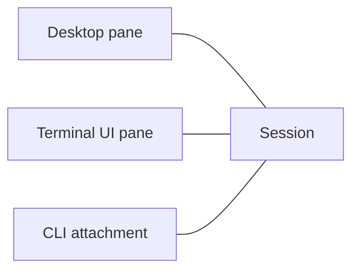
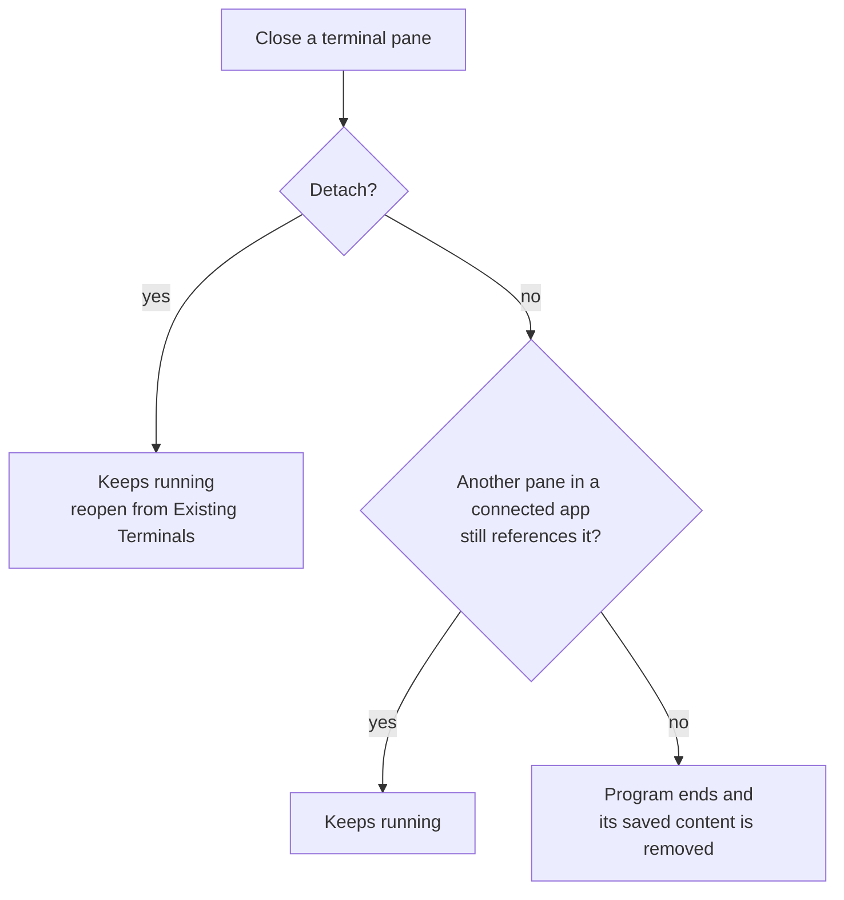
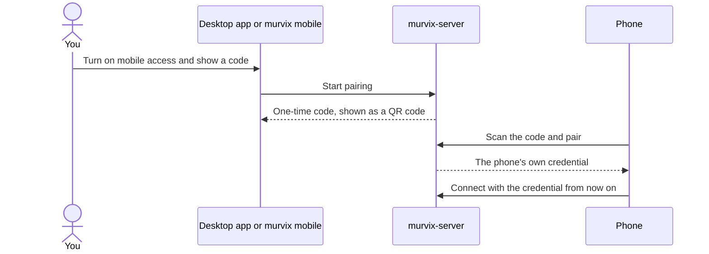

# Server model

`murvix-server` runs the terminals for every app. It runs on its own, apart from
the apps.

## Lifetime

- An app starts the server if it isn't running. The server keeps running until
  it is stopped, or until an update replaces it once no terminals are left.
- Stopping or restarting it ends every terminal but keeps settings and each
  terminal's saved content. Terminal programs are never restarted automatically.

## Sessions

A session is one terminal. It belongs to the project it was created in; its
current folder never changes that.

A session keeps running until its program exits, someone ends it, or the server
stops. By default, closing its last pane in connected apps also ends it.
Quitting an app, a crash, detaching, or sleeping does not itself send an end
request, and the server imposes no session timeout. A saved layout in an app
that is disconnected does not protect a session from being ended by a close in
another connected app.

## Sharing a session

- Several clients can show a session and type into it at once. They share one
  terminal size; resizing it affects everyone.
- The earliest connected client participating in the session is reported as its
  owner. Participation includes layout references, even in hidden tabs, as well
  as attachments. When that client leaves, the next participant takes over.
  Ownership only labels the session in Existing Terminals; it grants nothing
  extra.
- Panes you can't see, such as those in background tabs, still count as showing
  their session. They stop getting screen updates until shown again.

## Closing a pane

- If a program other than the shell is running, you confirm once. Background
  jobs alone don't ask.
- If the server is offline, the close waits and is decided on reconnect.
- Ending a session or deleting its project affects every app, unlike closing
  one pane.

## History

- Attaching shows the current screen and recent history. Older history loads as
  you scroll.
- History size is a byte budget in server settings. The server reports how many
  rows it holds.
- The server saves each terminal's screen and history, even when no app is
  watching, so it is still there after the program ends or the server restarts.
  A crash may lose the last moments of output.
- Ended sessions and their saved output are automatically removed after 7 days.
  `murvix session list` shows live sessions; use `--all` to include saved ones.

## Git and files

The server runs Git and file operations for its projects, such as worktrees,
changes, and reading files. Clients connected to that server operate on its
repository and files, including clients using the implemented TLS device
transport.

## AI activity

- The server spots supported AI agents from the running program and what's on
  screen. It needs no plugins and works while no app is attached. Recognition
  is best effort.
- It keeps at most one unread event per session, in memory only. Once seen, an
  event is cleared for every app. Restarting the server clears everything.

## Mobile transport and planned clients

The server, desktop settings, CLI pairing controls, and Rust client implement
TLS device access. This repository does not ship a phone app. The phone steps
below describe the intended client flow, not an available phone UI.

- Mobile access is off until you turn it on.
- A pairing code works once and expires after five minutes. Closing the desktop
  pairing view or ending the CLI pairing command cancels the pending code.
- A paired client has terminal, project, Git, and file access. It cannot use the
  management APIs for mobile access, server settings, stopping the server, or
  running programs outside a terminal (`exec`). These API restrictions are not
  a sandbox: a terminal already has the server user's shell access.
- Revoking a paired device, or turning mobile access off, disconnects it at once.
- Pairing can also be started on another computer with
  `murvix --host <computer> mobile pair`. This is an SSH management command from
  the desktop computer or CLI, not a shipped phone SSH client.
