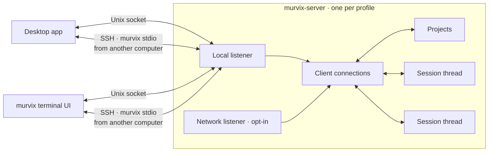
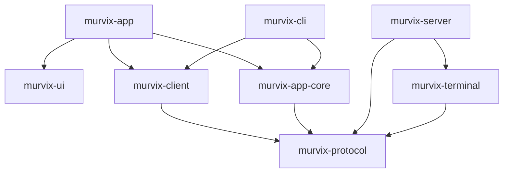
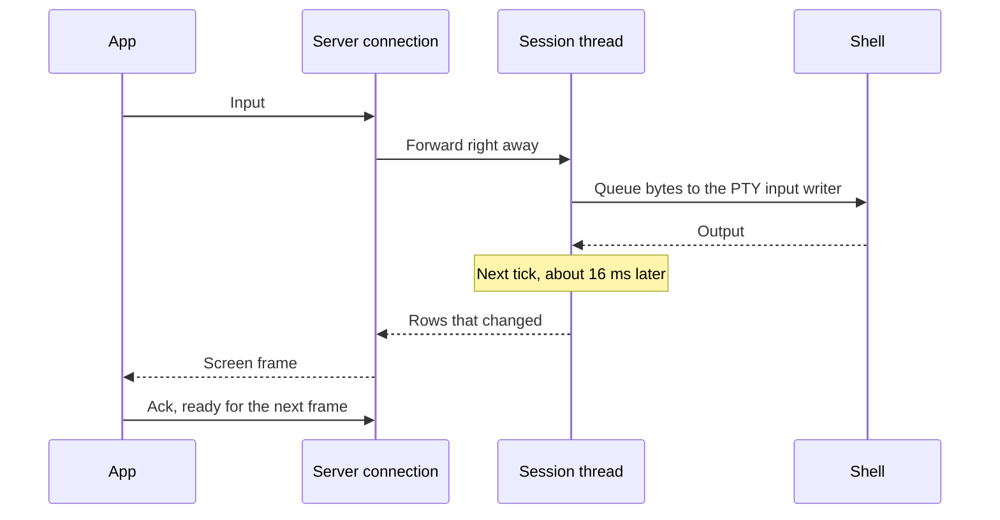
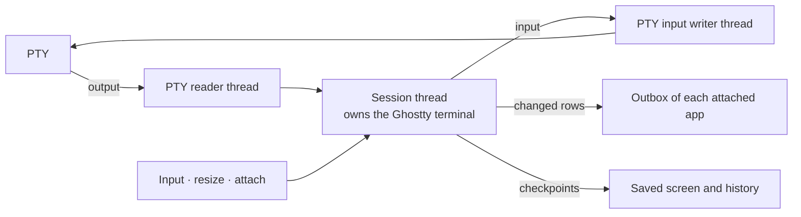
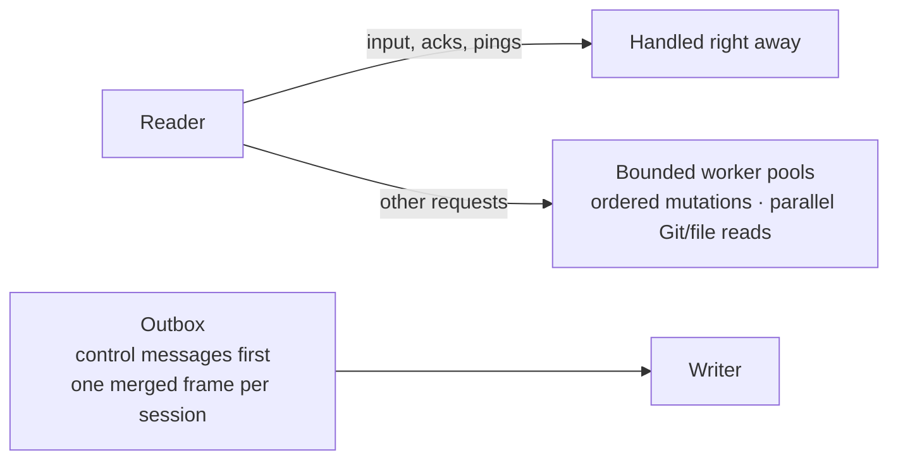

# Architecture

The processes, the crates, and how data moves between them.

## Processes

- Desktop release packaging includes the `murvix` and `murvix-server`
  executables; separate CLI/server packages can also be built. Either app
  starts the server if it isn't running. See [installation](../user-guide/getting-started.md)
  for current build and release availability.
- The server keeps projects and which sessions belong to them. Apps keep tabs,
  panes, and order.
- The desktop app keeps a connection per server: this computer's, and one per
  remote device. A second connection to each carries extension work and remote
  file transfers, so they never wait behind terminal traffic.
- Apps never include server code. They only speak the [protocol](./protocol.md).

## Crates

| Crate | Role |
| --- | --- |
| `murvix-app` | The desktop app. |
| `murvix-ui` | Reusable GPUI components and native web views. No app state. |
| `murvix-app-core` | UI-independent app models and services for layouts, settings, extensions, and desktop features; layout state is shared with the terminal UI. |
| `murvix-cli` | The `murvix` command: CLI and terminal UI. |
| `murvix-client` | Connects to a server, starting a local one if needed. |
| `murvix-protocol` | Messages, encoding, screen types, and transports. |
| `murvix-server` | The server: projects, sessions, history, Git, files, and paired-device access. |
| `murvix-terminal` | Wraps the Ghostty terminal and the PTY. |
| `murvix-core` | Shared basics, such as folders, locks, the shortcut catalog, and the app language. |

## Typing a key

## Inside a session

- One thread owns each terminal for its whole life. The Ghostty terminal isn't
  thread-safe, so everything else sends that thread messages.
- A separate thread reads the PTY and forwards bytes. Chatty programs
  produce many tiny reads. Another thread writes input, keeping a blocked PTY
  write from stalling the terminal owner.
- Every tick, if anything changed, the session sends the changed rows and the
  cursor. If nothing changed, nothing is sent.
- When output goes quiet after a burst, history is compressed.
- A background writer saves screen and history checkpoints, normally scheduled
  one second after output starts changing, and a final snapshot when a session
  ends. Saved output survives server restarts; running processes do not, and an
  abrupt failure can lose output not yet written.

## Inside a connection

- Each app has its own connection and outbox, so a slow app does not hold up
  another app's frame acknowledgements.
- The reader dispatches disk and process work without waiting for completion.
  General requests, Git mutations, and file mutations each have an ordered
  worker; Git and file reads use separate parallel pools. Exec jobs are
  cancellable and run independently.
- Screen updates merge: a newer frame folds into the one not yet sent, which
  goes out once the app acknowledges the previous one.
- Replies and other control messages are selected before pending screen data.

## Drawing in the app

- For each visible terminal, the app keeps the screen rows as styled runs, plus
  any history it has fetched.
- It repaints a pane only when a frame arrives or the view changes: one text
  line per row and one rectangle per color run.
- Hidden terminal panes detach but keep their last screen and scroll position
  in memory, and the server still counts them as showing their session. They
  attach again when shown, displaying cached content first, even while offline.
- The UI is built from `murvix-ui` components. Every app shortcut comes from one
  catalog, resolved through the keymap. Terminal preferences and key
  bindings live in `terminal.toml`, and the Quick Terminal's global shortcut is its own setting.

## Extensions and web views

- Web views use native WebKit on macOS and offscreen WebKitGTK on Linux, and
  stay alive while hidden. Extensions access terminal and server state only
  through the app's permission-checked API.
- The app loads extensions, enforces their permissions, and asks before
  sensitive actions. Their scripts run in JavaScriptCore on their own threads.
- File, Git, and process work goes through the server. Extension web requests
  run in the app and can't reach the local machine or private networks.
- Marketplace packages are verified before they are installed.
- Language packs are resource-only bundles. The app reads their catalogs, checks
  that each translation keeps its key's placeholders, and runs nothing from them.

## The browser

- Browser panes embed [polybrowser](https://github.com/saeedvaziry/polybrowser),
  which wraps the system WebKit view and keeps profiles and history.
- A page sits in the same native host as extension web views, so it hides under
  app content and shares the keyboard with Murvix's shortcuts.
- The server knows nothing about browsers. `murvix browser` reaches the desktop
  app over its own socket in the profile folder, `app.sock`, which only this
  user can open. One JSON request gets one JSON reply. The app explicitly closes
  the reply's write half after flushing it, so a completed call does not wait for
  other socket handles to be dropped.

## AI activity

- Each session thread checks the running program, the title, and the screen
  against built-in rules to find agents and their state.
- Apps get agent status from the server. They never read terminal output
  themselves.
- One desktop app delivers system notifications, so alerts are never doubled.

## Updates

The following is the implemented update policy for installed release packages.
Automatic checks are disabled in debug builds, and downloads require a
published update feed.

- If the new app speaks the running server's protocol version, the server keeps
  running and is replaced once no terminals are left.
- Otherwise the update waits for every terminal to end, or ends them after the
  user confirms.
- The old app bundle is kept until its server exits.
- Linux user installs switch one symlink between complete version directories.
  Runtime leases keep old helpers available while apps, CLIs or servers use
  them; one previous version is also retained for rollback. Download checksums,
  package manifests and all three executable build identities are verified
  before activation. Package-manager paths are never replaced by this updater.
